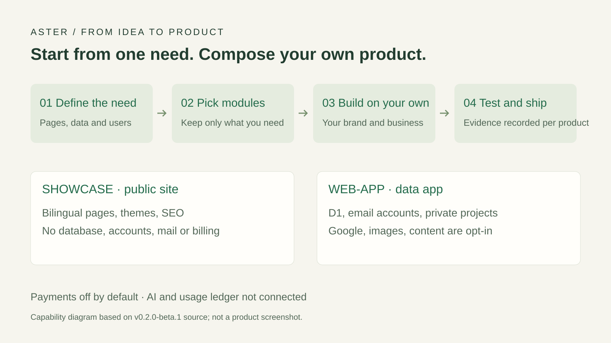

# Aster

**A reliable starting point for your agent.**

English · [简体中文](README.zh-CN.md)

Aster is a full-stack web product template: TanStack Start + React + TypeScript on Cloudflare Workers and D1, with Better Auth for accounts, Drizzle for data, and the [Flatpack](https://github.com/iamwilllee/flatpack) design system for the UI. It ships an Agent Skill. Describe what you want in one sentence and your agent initializes a standalone product that runs locally.

**v0.2.0-beta.1 · MIT · public preview without payments**

[Website](https://aster.iamwilllee.com/) · [Get started](#run-the-local-preview) · [Hand it to an agent](#let-an-agent-take-over) · [Release notes](https://github.com/iamwilllee/aster/releases/tag/v0.2.0-beta.1)

<sub>The cover is an AI concept image, not a screenshot of the software.</sub>

## Built with Aster

**[Makenue](https://makenue.iamwilllee.com/)** is a home for independent makers' products and supporters. It brings their work, thinking and scoped paid help into one place. It is a real product built on this template.

<!-- TODO: add a real Makenue screenshot at docs/readme/assets/makenue.png once approved for public use -->

## Pick a starting point

| Profile    | Good for                                           | Defaults                                                                                    |
| ---------- | -------------------------------------------------- | ------------------------------------------------------------------------------------------- |
| `showcase` | Marketing sites, portfolios, product pages         | Bilingual pages, themes and SEO. No database, accounts, mail or billing.                    |
| `web-app`  | Private libraries, tools, data products with login | D1, email/password accounts, mail and a private-project example. Everything else is opt-in. |

For an existing app, Aster inspects it first and adopts modules incrementally. Your business logic, brand, Git history and config stay as they are.



<sub>The diagram follows the current version. Optional capabilities are configured and verified per product.</sub>

## Run the local preview

Requires **Node.js 22.12 or later (CI verifies 24) and pnpm 12.11.2**. The core local flow needs no Cloudflare, mail or payment account.

```sh
git clone --branch v0.2.0-beta.1 --depth 1 https://github.com/iamwilllee/aster.git
cd aster
pnpm install --frozen-lockfile
pnpm setup
pnpm dev
```

Open the [English preview](http://127.0.0.1:3100/) or the [Chinese preview](http://127.0.0.1:3100/zh). Sign up, open the verification link from the local test inbox, then sign in. `setup` writes local config and unique secrets and migrates the local D1 database. Running it again keeps existing config and data. There is no preset admin and no shared password.

## Let an agent take over

```sh
pnpm skill:install
```

Then describe the product in your target project's Codex chat:

```text
$aster-new Build a private code snippet library in this project:
create, search, edit and delete, English and Chinese, works on mobile.
Finish a local first version and do not deploy.
```

You can also create a separate directory with the CLI:

```sh
pnpm aster:new ../snippet-shelf --name "Snippet Shelf" --profile web-app
pnpm aster:new ../my-site --name "My Site" --profile showcase
```

The CLI prepares the base and examples. The agent builds the business features. An existing README is kept and the new notes go to `ASTER.md`. Initialization creates no cloud resources and starts no services.

[Agent guide](docs/en/AGENT-GUIDE.md) · [Page blueprints](docs/en/PAGE-BLUEPRINTS.md) · [Upgrading existing products](docs/en/UPGRADING.md)

## Status and limits

- Payments are off by default. Stripe and Creem are experimental TEST adapters, not supported production billing.
- AI and the usage ledger are not connected yet.
- Google sign-in, private images and content management are optional modules, not defaults for every product.
- The license is free. Cloud, domain, mail and model costs are separate, and a full product is not promised to run at zero cost forever.

See [module selection](docs/en/MODULES.md), [release scope](docs/en/releases/0.2.0-beta.1.md) and [costs](docs/en/COSTS.md).

<details>
<summary>Maintainers: checks, recovery and deployment</summary>

```sh
pnpm check
pnpm format:check
pnpm exec playwright install chromium
pnpm test:e2e
pnpm test:production
pnpm flatpack:sync --check   # synced components and styles were not edited by hand
pnpm project:doctor
pnpm project:status
pnpm project:resume
```

`project:check --ready` checks project records and required evidence. It does not replace real business acceptance. Production tests use an isolated environment. Real mail, Google, R2 and cloud releases must be connected and verified per product.

[Development](docs/en/DEVELOPMENT.md) · [Deployment](docs/en/DEPLOYMENT.md) · [Database](docs/en/DATABASE.md) · [Account lifecycle](docs/en/ACCOUNT-LIFECYCLE.md)

</details>

## More

[Original guide (Chinese)](docs/project-guide.md) · [All docs](docs/en/README.md) · [Themes](docs/en/THEMES.md) · [Files](docs/en/FILES.md) · [Content](docs/en/CONTENT.md) · [Security](SECURITY.md) · [MIT License](LICENSE)
