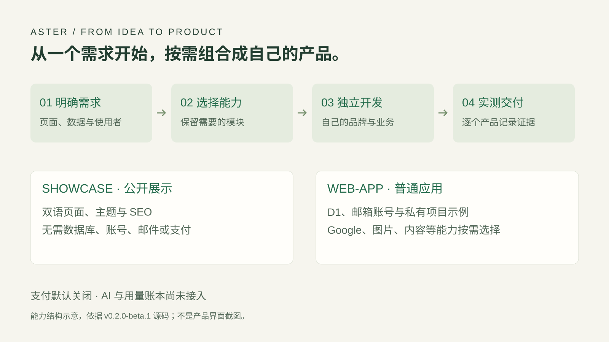

# Aster

**给 Agent 一个可靠的起点。**

面向独立开发者与 AI 辅助开发的开源 Web 产品底座。把账号、私有数据、主题和开发规范放在一起，从一个具体需求开始，按需做成自己的产品。

**v0.2.0-beta.1 · MIT · 无支付公开预览版**

[下载与版本说明](https://github.com/iamwilllee/aster/releases/tag/v0.2.0-beta.1) · [开始使用](#先跑起本地预览) · [交给 Agent](#让-agent-接着做) · [完整原说明](docs/project-guide.md)

<sub>封面为 AI 概念配图，用构筑与连接表达产品底座；不是软件界面。</sub>

## 少搭一些重复的东西，多做一点自己的产品

| 从哪里开始           | Aster 提供什么                                                 |
| -------------------- | -------------------------------------------------------------- |
| 想做一个展示站       | 双语页面、主题、SEO 和页面组合，不强制接入账号或数据库         |
| 想做一个带数据的应用 | 邮箱账号、私有项目示例、会话和资料管理、D1 持久化              |
| 已经有一个项目       | 先检查原工程，再按模块增量采用；保留业务、品牌、Git 和已有配置 |
| 与 Agent 协作开发    | Skill、目录约定、需求与交接文档、初始化恢复和采用记录          |



<sub>结构图依据当前版本整理。可选能力需要各产品单独配置与验收。</sub>

## 选一条更合适的起点

| 组合       | 适合做什么                             | 默认取舍                                               |
| ---------- | -------------------------------------- | ------------------------------------------------------ |
| `showcase` | 官网、作品集、产品展示站               | 保留双语、主题与 SEO；不需要数据库、账号、邮件或支付   |
| `web-app`  | 私人资料库、工具应用、带登录的数据产品 | D1、邮箱密码账号、邮件和私有项目示例；其他能力按需选择 |

Google、私有图片与内容管理是可选模块。源码预览展示了部分可选能力，不代表每个新产品都默认启用。Sage 与 Catalog 两套主题都支持浅色和深色；新产品可以拥有自己的视觉方向。

**支付默认关闭。** Stripe / Creem 保留为实验 TEST 适配，不属于正式收款支持；AI 和用量账本尚未接入。详见[模块选择](docs/MODULES.md)、[版本边界](docs/releases/0.2.0-beta.1.md)。

## 先跑起本地预览

建议使用 **Node.js 24、pnpm 12.11.2**。本地核心流程不需要 Cloudflare、邮件或支付账户。

```sh
git clone --branch v0.2.0-beta.1 --depth 1 https://github.com/iamwilllee/aster.git
cd aster
pnpm install --frozen-lockfile
pnpm setup
pnpm dev
```

打开 [英文预览](http://127.0.0.1:3100/) 或 [中文预览](http://127.0.0.1:3100/zh)。注册后从本地测试收件箱打开验证链接，再登录工作台。

`setup` 生成本地配置和独立密钥，并迁移本地 D1；重复执行保留已有配置和数据。没有预置管理员或共享密码。本地收件箱含验证和重置链接，开发服务只监听本机。

## 让 Agent 接着做

先在底座目录安装 Skill：

```sh
pnpm skill:install
```

然后在目标项目的 Codex 聊天中说明需求，例如：

```text
$aster-new 在当前项目做一个私人代码片段库：
支持新建、搜索、编辑和删除，中英文和手机可用。
完成本地首版，暂不部署。
```

也可以先用 CLI 创建独立目录：

```sh
pnpm aster:new ../snippet-shelf --name "Snippet Shelf" --profile web-app
# 只做公开展示
pnpm aster:new ../my-site --name "My Site" --profile showcase
```

CLI 准备底座与示例，业务功能由 Agent 继续完成。已有 README 保留，新说明写入 `ASTER.md`；已有应用先检查，不强制换架构。初始化不会创建云资源或自动启动服务。

[Agent 使用指南](docs/AGENT-GUIDE.md) · [页面组合](docs/PAGE-BLUEPRINTS.md) · [已有产品升级](docs/UPGRADING.md)

<details>
<summary>维护者：检查、恢复与部署</summary>

```sh
pnpm check
pnpm format:check
pnpm exec playwright install chromium
pnpm test:e2e
pnpm test:production
pnpm project:doctor
pnpm project:status
pnpm project:resume
```

`project:check --ready` 检查项目记录与必要证据，不替代实际业务验收。生产测试使用隔离环境；真实邮件、Google、R2 与云端发布需要按产品分别接入和验证。

[开发手册](docs/DEVELOPMENT.md) · [部署](docs/DEPLOYMENT.md) · [数据库](docs/DATABASE.md) · [成本](docs/COSTS.md) · [账号生命周期](docs/ACCOUNT-LIFECYCLE.md)

</details>

## 继续了解

[完整原说明](docs/project-guide.md) · [主题](docs/THEMES.md) · [图片](docs/FILES.md) · [内容管理](docs/CONTENT.md) · [安全](https://github.com/iamwilllee/aster/blob/d5f0ee8d16ae39e736f4d7f1e0c0fb37ac03ca3a/SECURITY.md) · [MIT 许可](LICENSE)

开源许可免费，云服务、域名、邮件、模型与其他服务费用分别计算；不承诺完整产品可以永久零成本运行。
