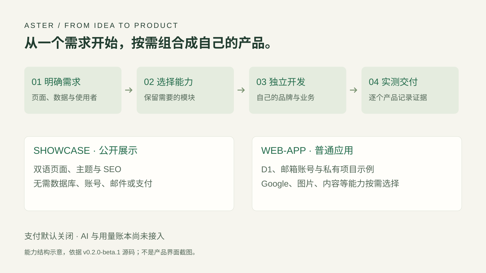

# Aster

**给 Agent 一个可靠的起点。**

[English](README.md) · 简体中文

Aster 是一个全栈 Web 产品模板：TanStack Start + React + TypeScript，运行在 Cloudflare Workers 与 D1，账号用 Better Auth，数据层用 Drizzle，界面来自设计系统 [Flatpack](https://github.com/iamwilllee/flatpack)。它自带一个 Agent Skill：你用一句话描述需求，Agent 就能在当前目录初始化出一个独立、可本地运行的产品。

**v0.2.0-beta.1 · MIT · 无支付公开预览版**

[官网](https://aster.iamwilllee.com/) · [开始使用](#先跑起本地预览) · [交给 Agent](#让-agent-接着做) · [版本说明](https://github.com/iamwilllee/aster/releases/tag/v0.2.0-beta.1)

<sub>封面为 AI 概念配图，不是软件界面。</sub>

## 用 Aster 做出的产品

**[Makenue](https://makenue.iamwilllee.com/)**：独立开发者的产品与支持者主页，把作品、思路和有边界的付费帮助放在同一个地方。它是用这套底座做的真实产品。

<!-- TODO: 放一张 Makenue 的真实截图：docs/readme/assets/makenue.png（需要你确认可公开） -->

## 选一条起点

| 组合       | 适合做什么                             | 默认取舍                                               |
| ---------- | -------------------------------------- | ------------------------------------------------------ |
| `showcase` | 官网、作品集、产品展示站               | 保留双语、主题与 SEO；不需要数据库、账号、邮件或支付   |
| `web-app`  | 私人资料库、工具应用、带登录的数据产品 | D1、邮箱密码账号、邮件和私有项目示例；其他能力按需选择 |

已有项目也可以采用：先检查原工程，再按模块增量接入，保留业务、品牌、Git 和已有配置。



<sub>结构图依据当前版本整理。可选能力需要各产品单独配置与验收。</sub>

## 先跑起本地预览

需要 **Node.js 22.12 以上（CI 验证 24）、pnpm 12.11.2**。本地核心流程不需要 Cloudflare、邮件或支付账户。

```sh
git clone --branch v0.2.0-beta.1 --depth 1 https://github.com/iamwilllee/aster.git
cd aster
pnpm install --frozen-lockfile
pnpm setup
pnpm dev
```

打开 [英文预览](http://127.0.0.1:3100/) 或 [中文预览](http://127.0.0.1:3100/zh)。注册后从本地测试收件箱打开验证链接，再登录工作台。`setup` 生成本地配置和独立密钥，并迁移本地 D1；重复执行保留已有数据。没有预置管理员或共享密码。

## 让 Agent 接着做

```sh
pnpm skill:install
```

然后在目标项目的 Codex 聊天中说明需求：

```text
$aster-new 在当前项目做一个私人代码片段库：
支持新建、搜索、编辑和删除，中英文和手机可用。
完成本地首版，暂不部署。
```

也可以用 CLI 创建独立目录：

```sh
pnpm aster:new ../snippet-shelf --name "Snippet Shelf" --profile web-app
pnpm aster:new ../my-site --name "My Site" --profile showcase
```

CLI 准备底座与示例，业务功能由 Agent 继续完成。已有 README 保留，新说明写入 `ASTER.md`。初始化不会创建云资源或自动启动服务。

[Agent 使用指南](docs/AGENT-GUIDE.md) · [页面组合](docs/PAGE-BLUEPRINTS.md) · [已有产品升级](docs/UPGRADING.md)

## 现状与限制

- 支付默认关闭。Stripe / Creem 只是实验性的 TEST 适配，不属于正式收款支持。
- AI 与用量账本尚未接入。
- Google 登录、私有图片、内容管理是可选模块，不是每个新产品默认启用。
- 开源许可免费；云服务、域名、邮件、模型等费用另算，不承诺完整产品永久零成本运行。

详见[模块选择](docs/MODULES.md)、[版本边界](docs/releases/0.2.0-beta.1.md)、[成本](docs/COSTS.md)。

<details>
<summary>维护者：检查、恢复与部署</summary>

```sh
pnpm check
pnpm format:check
pnpm exec playwright install chromium
pnpm test:e2e
pnpm test:production
pnpm flatpack:sync --check   # 同步来的组件与样式没有被手改
pnpm project:doctor
pnpm project:status
pnpm project:resume
```

`project:check --ready` 检查项目记录与必要证据，不替代实际业务验收。生产测试使用隔离环境；真实邮件、Google、R2 与云端发布需要按产品分别接入和验证。

[开发手册](docs/DEVELOPMENT.md) · [部署](docs/DEPLOYMENT.md) · [数据库](docs/DATABASE.md) · [账号生命周期](docs/ACCOUNT-LIFECYCLE.md)

</details>

## 继续了解

[完整原说明](docs/project-guide.md) · [English docs](docs/en/README.md) · [主题](docs/THEMES.md) · [图片](docs/FILES.md) · [内容管理](docs/CONTENT.md) · [安全](SECURITY.md) · [MIT 许可](LICENSE)
